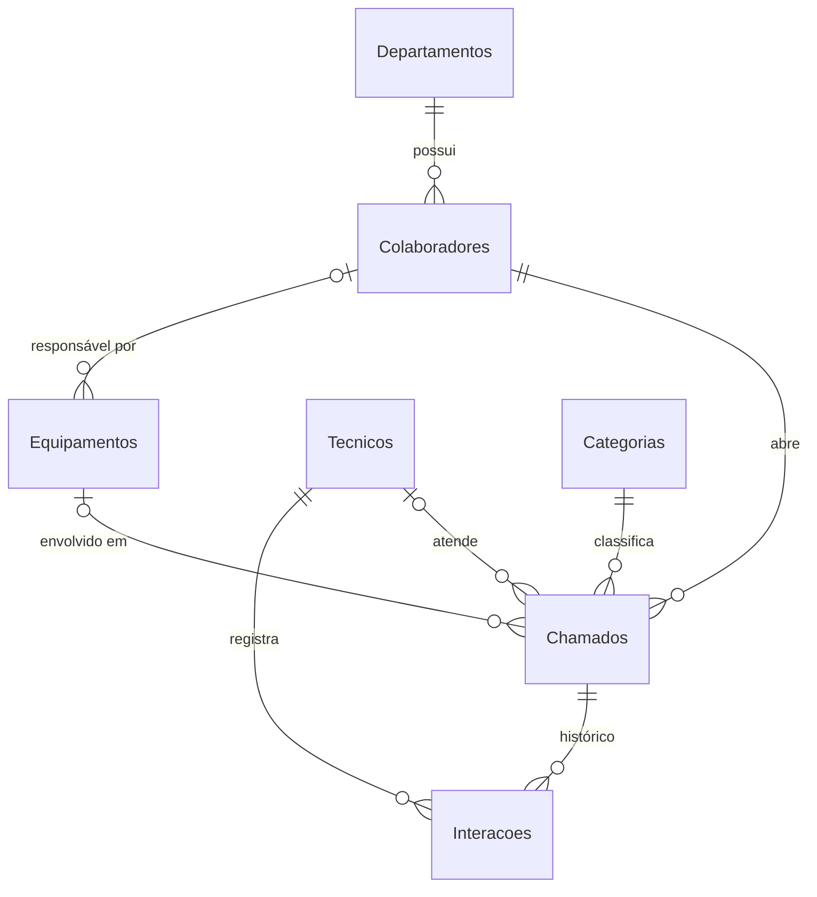

# 🛠️ SQL Help Desk: estudos de SQL Server

Base de dados de um **help desk de TI** fictício para praticar SQL Server, do `SELECT` básico a subconsultas e CTEs, com 10 desafios progressivos.

**Tecnologias:** SQL Server · T-SQL · SSMS · Git

> Material de estudo gerado com IA; as resoluções são minhas. [Saiba mais](#-sobre-este-projeto)

## 🧩 O cenário

A **Aurora Distribuidora** (empresa fictícia) tem colaboradores que abrem chamados, técnicos N1/N2/N3 que os atendem, categorias com prazo de atendimento (SLA) e um inventário de equipamentos.



7 tabelas · 430 registros · chaves primárias e estrangeiras, `UNIQUE`, `CHECK` e `DEFAULT`.

## ▶️ Como executar

1. Tenha o **SQL Server** (Express ou Developer) e o **SSMS** instalados.
2. Clone o repositório:
   ```bash
   git clone https://github.com/pedrobarbosaa/sql-helpdesk-estudos.git
   ```
3. No SSMS, execute os scripts da pasta `banco/` em ordem: `00` → `01` → `02` → `03` (o último confere a carga).

Para resetar a base, basta rodar os quatro scripts de novo.

## 🎯 Desafios

| # | Desafio | Conceitos | Status |
|---|---|---|:-:|
| 01 | Explorando os dados | SELECT, apelidos, colunas calculadas | ✅ |
| 02 | Filtrando chamados | WHERE, AND/OR, IN, LIKE, IS NULL | ✅ |
| 03 | Ordenando e removendo duplicatas | ORDER BY, DISTINCT, TOP | ✅ |
| 04 | Manutenção de dados | INSERT, UPDATE, DELETE, transações | ⬜ |
| 05 | Indicadores gerais | COUNT, SUM, AVG, MIN, MAX | ⬜ |
| 06 | Agrupando padrões | GROUP BY, HAVING | ⬜ |
| 07 | Relatório de chamados | INNER JOIN | ⬜ |
| 08 | Encontrando o que falta | LEFT JOIN, COALESCE | ⬜ |
| 09 | Desempenho e SLA | DATEDIFF, CASE | ⬜ |
| 10 | Perguntas compostas | Subconsultas, EXISTS, CTE | ⬜ |

Enunciados em [`exercicios/`](exercicios/README.md) · minhas resoluções em [`solucoes/`](solucoes).

## 🤖 Sobre este projeto

A base de dados, os enunciados e a metodologia de estudo foram gerados com o **Claude**, modelo de IA da Anthropic, para eu revisar e aprofundar meus conhecimentos de SQL Server. As resoluções e os comentários da pasta `solucoes/` são de minha autoria.

Para resolver os exercícios, priorizo a documentação oficial e outras referências. Em último caso, envio minha resolução para a IA revisar: ela aponta erros e sugere melhorias, sem entregar a resposta pronta.

## 👤 Autor das resoluções

**Pedro Henrique de Sousa Barbosa**
[LinkedIn](https://www.linkedin.com/in/pedrohenriquedesousa) · [GitHub](https://github.com/pedrobarbosaa)
