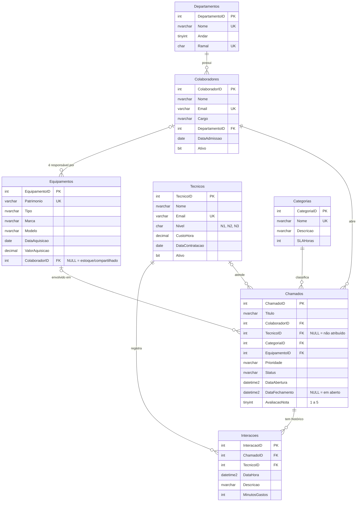

# 🛠️ SQL Help Desk: estudos práticos de SQL Server

Projeto de estudo e portfólio com uma base de dados de **help desk de TI** para praticar SQL do básico ao avançado: consultas, manipulação de dados, agregações, junções, subconsultas e CTEs.

O cenário simula a equipe de suporte da **Aurora Distribuidora** (empresa fictícia): colaboradores abrem chamados, técnicos N1/N2/N3 atendem, cada categoria tem um prazo (SLA) e o inventário de equipamentos é controlado por patrimônio.

> Todos os nomes, e-mails e dados são fictícios. O material de estudo foi gerado com auxílio de IA; as resoluções são minhas (veja [Sobre a criação deste material](#-sobre-a-criação-deste-material)).

## 🧰 Tecnologias

- **Microsoft SQL Server** (2019 ou superior; funciona no Express e no Developer, ambos gratuitos)
- **SQL Server Management Studio (SSMS)**
- **T-SQL**
- Git e GitHub

## 🗂️ Estrutura do repositório

```
sql-helpdesk-estudos/
├── README.md                  ← você está aqui
├── banco/
│   ├── 00_criar_banco.sql     ← cria (ou recria) o banco HelpDeskTI
│   ├── 01_criar_tabelas.sql   ← tabelas, PK, FK, UNIQUE, CHECK, DEFAULT e índices
│   ├── 02_inserir_dados.sql   ← carga de dados fictícios
│   └── 03_verificar_carga.sql ← confere contagens, restrições e acentuação
├── exercicios/
│   └── README.md              ← os 10 desafios, com critérios de correção
├── solucoes/
│   ├── 01_explorando_os_dados.sql
│   ├── ...
│   └── 10_subconsultas_ctes.sql
└── docs/
    └── metodologia.md         ← como estudar com este projeto
```

## 🧩 Modelo de dados



| Tabela | Registros | Finalidade |
|---|---:|---|
| `Departamentos` | 9 | Setores da empresa (um deles, *Auditoria Interna*, ainda sem pessoas) |
| `Colaboradores` | 32 | Usuários finais que abrem chamados (2 desligados) |
| `Tecnicos` | 7 | Equipe de suporte por nível (N1, N2, N3) e custo/hora |
| `Categorias` | 8 | Tipos de chamado e SLA em horas |
| `Equipamentos` | 54 | Inventário de TI; alguns em estoque, sem responsável |
| `Chamados` | 96 | Tabela central: solicitações de jan. a nov./2026 |
| `Interacoes` | 224 | Histórico de atendimento com o tempo gasto em cada ação |

**Regras de negócio garantidas pelo banco (exemplos):**
- prioridade só aceita *Baixa, Média, Alta, Crítica* (padrão: *Média*);
- status só aceita *Aberto, Em andamento, Aguardando usuário, Resolvido, Fechado* (padrão: *Aberto*);
- a data de fechamento não pode ser anterior à abertura;
- nota de avaliação entre 1 e 5; SLA, custo/hora e minutos sempre positivos;
- e-mails e patrimônios não se repetem.

Os dados foram planejados para os exercícios terem casos interessantes: chamados sem técnico, colaboradores sem chamados, categoria sem uso, chamados fora do SLA, escalonamento entre níveis e avaliações ausentes (`NULL`).

## ▶️ Como executar

1. Instale o **SQL Server** (Express ou Developer) e o **SSMS**.
2. Clone o repositório:
   ```bash
   git clone https://github.com/<seu-usuario>/sql-helpdesk-estudos.git
   ```
3. No SSMS, conecte-se à instância local (ex.: `localhost` ou `.\SQLEXPRESS`).
4. Abra e execute (**F5**) os scripts da pasta `banco/` **nesta ordem**:
   1. `00_criar_banco.sql`
   2. `01_criar_tabelas.sql`
   3. `02_inserir_dados.sql`
   4. `03_verificar_carga.sql`: confira se as contagens batem com a tabela acima.
5. Para **resetar** a base a qualquer momento, execute novamente os quatro scripts.

> **Acentuação:** os scripts estão em UTF-8. Se aparecer `Média` em vez de `Média`, reabra o arquivo no SSMS em *File → Open → (seta do botão Open) → Open With… → SQL Query Editor with Encoding* e escolha **UTF-8**.

## 🎯 Desafios

| # | Desafio | Conceitos |
|---|---|---|
| 01 | Explorando os dados | `SELECT`, `FROM`, apelidos, colunas calculadas |
| 02 | Filtrando chamados | `WHERE`, `AND`/`OR`, `IN`, `BETWEEN`, `LIKE`, `IS NULL` |
| 03 | Ordenando e removendo duplicatas | `ORDER BY`, `DISTINCT`, `TOP` |
| 04 | Manutenção de dados com segurança | `INSERT`, `UPDATE`, `DELETE`, transações, restrições |
| 05 | Indicadores gerais do help desk | `COUNT`, `SUM`, `AVG`, `MIN`, `MAX`, `NULL` em agregações |
| 06 | Agrupando para enxergar padrões | `GROUP BY`, `HAVING`, funções de data |
| 07 | Relatório de chamados encerrados | `INNER JOIN` com várias tabelas |
| 08 | Encontrando o que está faltando | `LEFT JOIN`, anti-join, `COALESCE` |
| 09 | Painel de desempenho e SLA | `DATEDIFF`, `CASE`, agregação condicional |
| 10 | Subconsultas, CTEs e perguntas compostas | subconsultas, `EXISTS`, CTE, funções de janela |

Enunciados completos e critérios de correção: [`exercicios/README.md`](exercicios/README.md).
Minhas resoluções comentadas: [`solucoes/`](solucoes).

## 📈 Progresso

- [x] 01 · [ ] 02 · [ ] 03 · [ ] 04 · [ ] 05
- [ ] 06 · [ ] 07 · [ ] 08 · [ ] 09 · [ ] 10

## 🤖 Sobre a criação deste material

A base de dados (scripts da pasta `banco/`), os enunciados dos exercícios e a metodologia de estudo foram **gerados com o Claude, modelo de IA da Anthropic**, a meu pedido. O objetivo era ter um ambiente prático e realista para **revisar e aprofundar meus conhecimentos de SQL Server**.

O que é de minha autoria:
- as **resoluções** da pasta [`solucoes/`](solucoes), escritas por mim, sem consultar respostas prontas;
- os comentários de raciocínio, interpretação dos resultados e aprendizados registrados em cada exercício.

Durante o estudo, também uso de pesquisas na internet e em documentações para lembrar sintaxe e melhores formas de usar os termos da linguagem.

## 👤 Resoluções

**Pedro Henrique de Sousa Barbosa**
[LinkedIn](https://www.linkedin.com/in/<www.linkedin.com/in/pedrohenriquedesousa>) · [GitHub](https://github.com/<https://github.com/pedrobarbosaa>)
